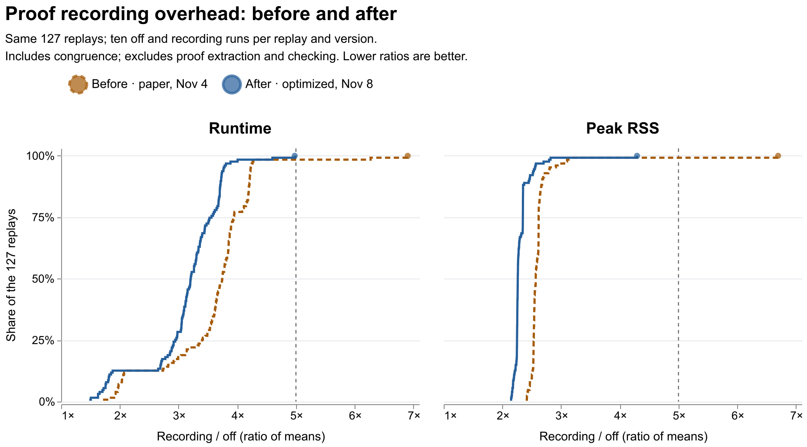
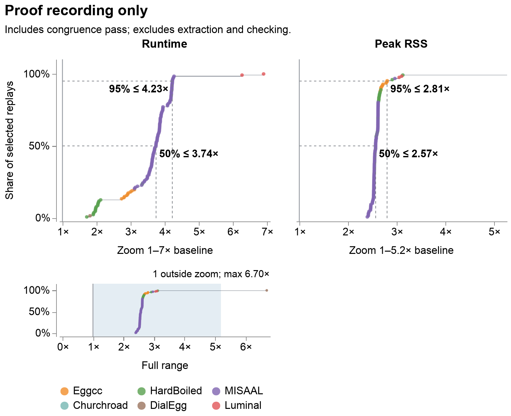
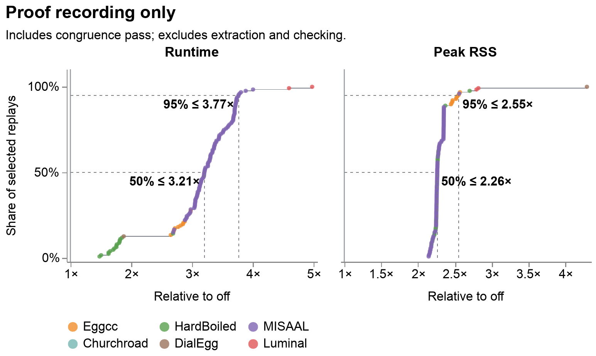

# Before and after proof recording

The comparison keeps all 127 original paper input identities. Recording includes congruence and excludes proof extraction and checking. Each ratio uses the same executable for its own off and recording endpoints.



The full-cohort curves compare the **original paper measurements from November 4** with the **accepted optimized measurements from November 8**, with ten observations per endpoint in each dataset. Both metrics and both versions use the same linear x domain; the grey rule is 5× and filled endpoints identify each maximum. The curves contain per-replay mean ratios and have no population confidence band. Historical before and optimized after were measured in separate sessions.

The plot values come directly from [the frozen cohort](../cohort.json) and [the final acceptance dataset](../final-acceptance.json). All 508 plotted inputs preserve their identities and exact ratios. The [Vega-Lite specification](recording-before-after.vl.json), [plot data](full-cohort-ratios.json), and [source provenance](comparison-provenance.json) are inspectable.

## Fresh baseline comparison for the original outliers

This table uses a separate fresh baseline on `e8a2a58d` (three observations per off/recording endpoint), then the final accepted `ede9f943` dataset (ten per endpoint). These baseline timings differ from the historical paper dataset plotted above. All observations succeeded. Both use the same inputs, startup settings and 16 GiB allocation guard; their timeouts are 60s and 500s respectively.

| Workload / metric | Off before → after | Recording before → after | Recording reduction | Recording/off before → after |
| --- | ---: | ---: | ---: | ---: |
| Gemma runtime | 0.3346 → 0.3216 s | 2.3664 → 1.6015 s | 32.3% | 7.072× → 4.979× |
| Gemma4 MoE runtime | 0.6973 → 0.6794 s | 4.3964 → 3.1241 s | 28.9% | 6.305× → 4.599× |
| DialEgg peak RSS | 132.88 → 132.88 MiB | 892.35 → 570.64 MiB | 36.1% | 6.716× → 4.294× |

Ratios and reductions use unrounded means. [Fresh outlier data](fresh-outlier-comparison.json) retain all three baseline measurements per endpoint, mean intervals, ratio intervals, and final estimates. The full final cohort has exactly 2,540 successful observations, all 127 runtime/RSS mean ratios below 5×. Gemma remains close to the threshold: **4.978895× with a 95% independent Fieller interval of [4.914324, 5.044428]**. This supports the stated mean criterion, with limited margin for measurement variation.

## Bottlenecks and resulting changes

- Luminal: baseline profiling places 42.3% of sampled CPU in typechecking. Fixed-signature checks, direct reads of already-bound eq-sort globals, less redundant generated-action parsing/resolution, unused internal fresh-ID pruning, and lazy canonical-ID interning reduce frontend work. Assignment lookup stays flat for inference, with persistent snapshots once an overload branch clones it and one initial capacity reservation. The sampled inclusive typechecking share is 30.35% after adaptive storage; inclusive shares overlap and are separate from wall-time observations.
- DialEgg: diagnostics identify 17.1 million hidden recording rows and excess flat-buffer capacity. Immutable constant-column chunks preserve logical rows, duplicates, deltas and IDs while avoiding repeated constant values and contiguous growth/copying.
- The source-generation/parser/typechecker pipeline remains in place. The strongly typed generation rewrite and typed Rust authoring API remain deferred. Eli’s pinned container stack conflicts across 13 downstream files and remains unmeasured here.
- API caveat: `Assignment.0` now holds `AssignmentMap`. Existing `Assignment` get/insert/clone consumers pass the workspace checks; callers constructing or iterating the former concrete map through `.0` may need adaptation.

## Paper figure layout

Before, at paper revision `310f3b4`: the memory overview sits beneath the runtime column.



After, from the accepted optimized bundle: both metrics fit full-range panels and there are no overview panels.



The original PDF is in `oflatt/extended-egglog-paper` at `310f3b4:figures/eval/corpus-proof-recording-cdf.pdf`; the after PDF and numeric exports were committed at `3045d9e`. The companion PR incorporates the current paper main without altering the accepted figure bytes.

## Validation and reproduction

Local `RUST_TEST_ARGS='--skip paper/' UV_PYTHON=3.12 make check` passes on the final production source. The earlier full paper run passed 510 tests and failed native Math12 at its 16 GiB guard. The user-requested uncapped-native/capped-source Math rerun passes both tests. The original failed full invocation remains explicit in [validation evidence](../final-validation.json). Native Math correctness now runs separately without a memory cap; benchmark measurements retain their selected guards.

The existing final figure audit checks all 254 metric points, and its numeric-export audit checks all 254 condition means/intervals, 127 comparisons and 3,556 per-replay TeX macros. This PR adds a separate [executed-Vega audit](plot-audit.json) of the shared-axis comparison and visually inspected PNG exports. No new benchmark observations were collected to prepare the PR.

From the repository root, render the comparison using the same pinned Vega toolchain as the existing figures:

```sh
npx --yes --package=vega@6.4.0 --package=vega-lite@6.4.3 \
  --package=vega-cli@6.4.0 --package=canvas@3.2.3 \
  vl2png goals/proof-recording-under-5x/comparison/recording-before-after.vl.json \
  /tmp/recording-before-after.png \
  --base goals/proof-recording-under-5x/comparison/ -s 2
npx --yes --package=vega@6.4.0 --package=vega-lite@6.4.3 \
  --package=vega-cli@6.4.0 --package=canvas@3.2.3 \
  node goals/proof-recording-under-5x/comparison/audit.mjs
```

The [main results report](../results.md) contains every per-replay mean and interval, final collection commands, and the retained/rejected experiment ledger.
